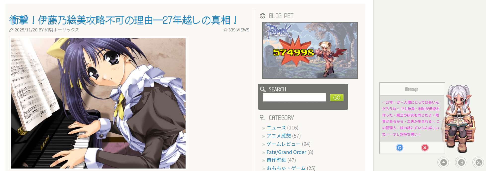

# MP Ukagaka

A WordPress plugin for creating interactive ukagaka (伺か) characters with AI-powered features.

🌍 **Other Languages**: [繁體中文](README_zh-TW.md) | [日本語](README_ja.md)

## 📢 Preface (Please Read)

This plugin is an extensively expanded version based on the original WordPress plugin "MP Ukagaka" released by Ariagle over 10 years ago.

> ⚠️ **Important Notice**: Approximately 90% of this plugin's code was developed using AI-assisted development (Vibe Coding). Although it has undergone countless rounds of debugging and improvements, there may still be unknown bugs or imperfect code structures. Please understand this risk before use.

📺 **Demo Site**: [https://www.moelog.com](https://www.moelog.com/)

### About Character Personality Creation

While this plugin provides the **Create New Character Personality** feature (see [GHOST_CREATE_GUIDE.md](docs-en/GHOST_CREATE_GUIDE.md)), development efforts have primarily focused on the default character "Frieren". Therefore, this feature has not been fully tested. Your understanding is appreciated.

If you simply want to use the default character "Frieren", basic dialogues are built-in and ready to use out of the box. For richer, more interactive conversations, we recommend configuring an AI model API Key. Additionally, the character memory configuration files ([personality.md](ghost/Frieren/personality.md) and [instructions.md](ghost/Frieren/instructions.md), containing memories from anime Season 1) are also built-in. You can configure your **Admin full nickname**, **Admin short name**, and **Admin birthday** (MM-DD format, e.g., `10-18`) directly in **Settings → MP Ukagaka → General Settings**. The personality files use `{{admin_nickname}}`, `{{admin_name}}`, and `{{admin_birthday}}` as placeholders — these are automatically filled in from your backend settings at runtime, so you no longer need to manually edit the personality files or `calendar.json`. The character will also celebrate your birthday automatically based on this setting.

### AI Model Recommendations

This plugin supports multiple AI providers including Gemini, OpenAI, Claude, and Ollama. For OpenAI, we now recommend **GPT-6 Luna**: it gives better value than GPT-4.1 mini, the previous recommendation.

| Model | Input (per 1M tokens) | Output (per 1M tokens) |
| --- | --- | --- |
| GPT-4.1 mini (previous) | $0.40 | $1.60 |
| **GPT-6 Luna** (recommended) | **$0.10** | **$0.50** |

- Input tokens cost **75% less** than GPT-4.1 mini, and output tokens about **69% less**.
- OpenAI retires GPT-4o, GPT-4o mini, GPT-4.1 and GPT-4.1 mini on **2027-01-14**. New installs already default to GPT-6 Luna, but an existing site keeps the model it has, so choose GPT-6 Luna under **LLM Settings** (and **Diary** if you use OpenAI there) before that date.
- `gpt-5.6-luna` also works if you enter it under "Custom model…".

## 📸 Screenshot

_Frieren character displaying AI-generated dialogue based on article content_

> 💡 **More Screenshots**:
>
> - `screenshot02.png` - LLM Settings: dialogue and Page Awareness switches
> - `screenshot03.png` - Interactive Chat Mode
> - `screenshot04.png` - LLM Settings: AI provider
> - `screenshot05.png` - Bot detection reaction
> - `screenshot06.png` - Abilities: a visitor is refused an admin-only tool
> - `screenshot07.png` - Abilities: reporting bot-blocker statistics
> - `screenshot08.png` - Gift / feeding picker
> - `screenshot09.png` - LLM-generated auto talk
> - `screenshot10.png` - Page Awareness comment on an article
>
> Project page: <https://horlicks-p.github.io/mp-ukagaka/>

## ✨ Core Features

- **Multiple Characters**: Create and manage multiple ukagaka characters
- **AI Context Awareness**: Intelligent responses using Gemini, OpenAI, Claude, or Ollama
- **Interactive Chat Mode**: Real-time conversations with visitors, including SSE streaming responses
- **Gifts & Feeding**: Visitors can hand the character food or gifts in Chat Mode, with a message attached
- **Sleep & Waking**: Night sleep, oversleeping and daytime naps, with a wake-up animation when you talk to her
- **Abilities**: Ask in chat for popular posts or bot-blocker stats, or have the character ban an IP (admin)
- **AI Diary, Weather & Calendar**: Occasional diary posts, local weather and seasonal events woven into dialogue
- **External Dialog Files**: Support for TXT and JSON format dialogues
- **Canvas Animation**: Single image or multi-frame animation support
- **Multi-Language**: English, Traditional Chinese, and Japanese
- **Security First**: API key encryption, CSRF protection, XSS prevention

## 🚀 Quick Start

### Installation

1. Download `mp-ukagaka.zip` from the [latest release](https://github.com/Horlicks-p/mp-ukagaka/releases/latest) (not GitHub's "Source code" archive, whose folder name differs)
2. In WordPress Admin → **Plugins → Add New → Upload Plugin**, upload the ZIP and activate it
3. Go to **Settings → MP Ukagaka**

Later versions show up as normal plugin updates in the WordPress admin.

### Basic Setup

1. **General Settings**: Choose default character and configure display settings
2. **Create Character**: Add character with image URL and dialogues
3. **Dialog Files**: Dialogues are automatically saved to `dialogs/` folder

### Enable AI Features (Optional)

**LLM Settings**:

- Choose provider: Ollama (free), Gemini, OpenAI, or Claude
- Enter API key (automatically encrypted) or configure Ollama endpoint
- Check "Enable context awareness" to turn on AI comments and the first-visit greeting
- Optionally check "Use LLM to replace built-in dialogues" for AI-generated auto talk
- Check "Enable interactive chat feature" for Chat Mode — the dock's change-character button becomes a chat button

**AI Settings**:

- Set trigger probability (10-30% recommended for cost control) and trigger pages
- The character's personality comes from its own `personality.md` / `instructions.md`; the System Prompt field here is only a fallback for characters without them

## 🤖 AI Providers

| Provider   | Cost     | Setup                                                                     |
| ---------- | -------- | ------------------------------------------------------------------------- |
| **Ollama** | Free     | Install locally or connect to remote server                               |
| **Gemini** | Paid API | Get key from [Google AI Studio](https://makersuite.google.com/app/apikey) |
| **OpenAI** | Paid API | Get key from [OpenAI Platform](https://platform.openai.com/api-keys)      |
| **Claude** | Paid API | Get key from [Anthropic Console](https://console.anthropic.com/)          |

## 📚 Documentation

For detailed information, please refer to:

- **[User Guide](docs-en/USER_GUIDE.md)** - Complete setup and configuration guide
- **[Developer Guide](docs-en/DEVELOPER_GUIDE.md)** - Architecture and development info
- **[API Reference](docs-en/API_REFERENCE.md)** - Function, hook and REST reference
- **[Ghost Create Guide](docs-en/GHOST_CREATE_GUIDE.md)** - Making your own character
- **[Abilities API](docs-en/ABILITIES_API.md)** - Tools the character can call, and adding new ones
- **[Changelog](docs-en/CHANGELOG.md)** - Version history

## 🎉 What's New in v2.38.3

**A heads-up before GPT-4o and GPT-4.1 retire** (v2.38.3): If chat or the diary still uses an OpenAI model that retires on 2027-01-14, the admin screens now show a warning with a link to the setting to change. Expression tags written loosely, such as `[ laugh ]` or `[laugh.]`, now switch the expression while a reply is streaming. Provider errors no longer write prompts or the Gemini API key to the PHP error log.

**Visitors stay visitors** (v2.38.2): With GPT-6 Luna, the character sometimes greeted a visitor by the admin's name, as if the admin had come back. The admin's name and birthday, and the lines meant for the admin, are now only used while the admin is logged in.

**Fullwidth tags while streaming** (v2.38.1): When the AI wrote an expression tag with fullwidth brackets, such as `【laugh】`, a streamed reply showed the tag as text and the character's face did not change. The tag now switches the expression and disappears from the text, just like `[laugh]`.

**Earlier releases**: ready for GPT-6 Luna (v2.38.0), retries that know who they are for (v2.37.4), switching without leftovers (v2.37.3), the right character, the right face (v2.37.2), talking again after hello (v2.37.1), expressions in your own dialogue (v2.37.0), a smoother message box without AI (v2.36.2), a tidier IP blocklist (v2.36.1), a grimoire in your colours (v2.36.0), small touches to the grimoire page (v2.35.1), a message box from a traveler's grimoire (v2.35.0), your own characters stay your own (v2.34.1), Frieren redrawn in SVG (v2.34.0), tidier status labels and documentation that matches the plugin (v2.33.3), chat and auto talk stop stepping on each other (v2.33.2), waking her actually wakes her (v2.33.1), vector dock buttons (v2.33.0), mood cues instead of decision trees for gift reactions (v2.32.3), context wins on a tie for gift reactions (v2.32.2), gift fixes (v2.32.1), gift reactions with something to say (v2.32.0), gift reactions that listen to the conversation they happen in (v2.31.0), frontend CSS modernization (v2.30.0), gift message attachment (v2.29.0), per-item variant substitution for gift reactions (v2.28.0), chat integrity session follow-up (v2.27.7), review follow-up hardening (v2.27.6), housekeeping and uninstall cleanup (v2.27.5), checksum window filtering (v2.27.4), gift reliability & checksum consolidation (v2.27.3), the 🎁 Gift / Feeding system (v2.27.0), daytime nap (v2.26.0), the frontend modular split (v2.25.7), authenticated AES-256-GCM key encryption (v2.25.6), and inline emotion tags (v2.25.0), among others.

[View Full Changelog](docs-en/CHANGELOG.md)

## ❓ Common Questions

**Why isn't AI triggering?**

- Check API key is valid
- Verify page matches trigger conditions (e.g., `is_single`)
- Ensure probability is set (try 100% for testing)
- Check content length (\>300 characters required)

**How to control API costs?**

- Set probability to 10-20%
- Use cheaper models (gemini-3.5-flash-lite, gpt-4.1-mini, gpt-4o-mini)
- Limit trigger pages to `is_single`

**LLM connection failed?**

- For Ollama: Ensure service is running on port 11434
- For remote: Check Cloudflare Tunnel or network connection
- Test connection using the test button in settings

[More FAQ in User Guide](docs-en/USER_GUIDE.md#faq)

## 🔒 Security Features

- **API Key Encryption**: AES-256-GCM encryption for all API keys
- **CSRF Protection**: WordPress nonce verification for all forms
- **XSS Prevention**: Input/output sanitization using WordPress core functions
- **Secure File Operations**: Path validation and WordPress Filesystem API

## 💬 Support

- Visit [MOELOG.COM](https://www.moelog.com/)
- Check [User Guide](docs-en/USER_GUIDE.md) and [FAQ](docs-en/USER_GUIDE.md#faq)
- Open an issue on GitHub

## 👥 Credits

- **Original Author**: Ariagle
- **Maintainer**: Horlicks ([MOELOG.COM](https://www.moelog.com/))
- **Inspired by**: Classic MP Ukagaka plugin / 伺か (Ukagaka)

## 📄 License

GPLv2 or later (see [LICENSE](LICENSE)). Based on the original MP Ukagaka plugin by Ariagle.

---

**Made with ❤ for the WordPress community**
